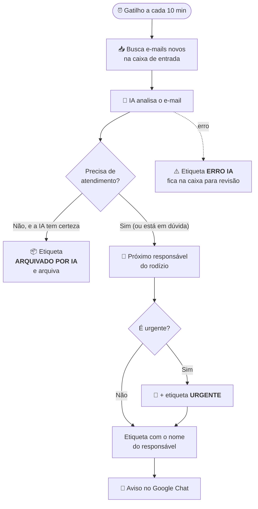

<div align="center">

# 📬 Triagem de E-mails com IA — Contas a Pagar

**A caixa de entrada do setor se organiza sozinha.**
Cada e-mail novo é lido por uma IA, que decide se ele precisa de atendimento, separa o que é urgente e distribui o trabalho entre a equipe — avisando todo mundo no Google Chat.


</div>

---

## 🤔 O problema

A caixa de e-mail do Contas a Pagar recebe de tudo: notas fiscais, boletos, cobranças, pedidos de outros setores, alterações bancárias… misturados com newsletters, propagandas, confirmações automáticas e respostas do tipo *"ok, obrigado"*.

Alguém precisava abrir **cada** e-mail, decidir se era importante e repassar para um colega. Isso toma tempo e, no meio do volume, um boleto vencendo hoje pode passar despercebido.

## ✨ A solução

A cada **10 minutos**, a automação olha a caixa de entrada e, para cada e-mail novo:

| | O que acontece |
|---|---|
| 🧠 **Lê e entende** | A IA analisa assunto, corpo, anexos, quem está em cópia e as mensagens anteriores da conversa. |
| 🗂️ **Classifica** | Identifica o tipo (nota fiscal, boleto, cobrança, alteração bancária…) e se precisa de alguém da equipe. |
| 🔴 **Detecta urgência** | Marca como **URGENTE** só quando há prejuízo real em até 48h: vencimento hoje, ameaça de protesto, corte de serviço… |
| 👥 **Distribui** | Repassa o e-mail para o próximo responsável, em **rodízio**, para dividir o trabalho por igual. |
| 📦 **Arquiva o que não importa** | Propagandas, newsletters e confirmações automáticas saem da caixa de entrada sozinhas. |
| 📣 **Avisa a equipe** | Envia um resumo no Google Chat, mencionando cada pessoa, com os urgentes no topo e um botão para abrir o e-mail. |

---

## 🔄 Como funciona



### 🏷️ Etiquetas no Gmail

| Etiqueta | Significado |
|---|---|
| `EDUARDO`, `IAN`, `NATALIA`, … | E-mail distribuído para essa pessoa atender. |
| `URGENTE` | Precisa de atenção nas próximas 48h. |
| `PROCESSADO POR IA` | A IA analisou e distribuiu. |
| `ARQUIVADO POR IA` | A IA considerou que não precisa de atendimento. |
| `Treinamento - IA` | Marcada **pela equipe**: exemplo que a IA consulta quando está em dúvida (veja [Ensinando a IA](#-ensinando-a-ia-com-exemplos)). |
| `ERRO IA` | Algo deu errado na análise — o e-mail **continua na caixa de entrada** para alguém olhar. |

### 💬 Exemplo do aviso no Google Chat

> 📬 Novos e-mails para **@Eduardo** (2 · 🔴 1 urgente), **@Ian** (1)
>
> **🔴 Triagem de e-mails** — 3 e-mails distribuídos · 1 urgente · 22/10 às 09:30
>
> **👤 EDUARDO · 2 e-mails**
> > *Cobrança · Papelaria Central*
> > 🔴 **URGENTE** · Boleto vencido com risco de protesto.
> > **2ª via boleto vencido**
> > Pagar boleto da NF 1234 vencido ontem para evitar protesto.
> > `[ Abrir e-mail ]`

---

## 🎓 Ensinando a IA com exemplos

A equipe pode dar à IA **exemplos reais do que não precisa de atendimento**, sem mexer em código. É um reforço: a IA continua decidindo pelas mesmas regras e **só consulta os exemplos quando fica em dúvida**.

1. No Gmail, aplique a etiqueta **`Treinamento - IA`** em e-mails que **não** precisam de atendimento (aquele aviso automático de sempre, a newsletter de um fornecedor, a confirmação de um sistema…).
2. Pronto. Na próxima execução, a IA recebe esses e-mails (assunto, remetente e um trecho) como material de consulta.

| | |
|---|---|
| 🧭 **As regras continuam mandando** | Os exemplos só pesam quando a IA está em dúvida; o que está claro pelas regras não muda. |
| 📌 **Os exemplos nunca são distribuídos** | E-mails com essa etiqueta ficam fora da triagem e podem continuar na caixa de entrada. |
| ⏱️ **Vale em até 1 hora** | Os exemplos ficam guardados por 60 min. Para valer na hora, rode `limparCacheTreinamento()`. |
| 🔢 **Até 30 exemplos** | Os mais recentes da etiqueta. O limite fica em `MAX_EXEMPLOS_TREINAMENTO`, no `config.gs`. |

> 💡 **Dica:** prefira um exemplo de cada "tipo" de e-mail. Dez cópias do mesmo aviso ensinam o mesmo que uma.

---

## 🛡️ Feito para não perder nada

A automação foi pensada para **errar para o lado seguro**:

- **Na dúvida, distribui.** Se a IA quiser arquivar mas a confiança for menor que 70%, o e-mail vai para alguém da equipe.
- **Alteração bancária nunca é arquivada.** Pedidos de troca de conta ou PIX — principalmente de domínios estranhos ou com tom de pressão — sempre vão para conferência humana, por risco de golpe.
- **"Urgente" no assunto não basta.** Marketing que grita *"URGENTE!!!"* não engana a classificação; só conta prazo ou consequência real.
- **Erro não some com e-mail.** Se a IA falhar, o e-mail ganha a etiqueta `ERRO IA` e fica na caixa de entrada.
- **Tenta de novo sozinha.** Falhas temporárias da OpenAI são repetidas automaticamente, com espera crescente.
- **Uma execução por vez.** Uma trava impede que duas execuções rodem juntas e baguncem o rodízio.
- **Nenhum segredo no código.** Chave da OpenAI, webhook do Chat e e-mails da equipe ficam nas *Propriedades do Script*.

---

## 🗂️ Estrutura do projeto

```
📁 cp-email-triage-ai
├── 🏢 unidade.gs         Perfil do setor: nome, equipe, tipos e regras da IA
├── ⚙️ config.gs          Configurações técnicas: modelo, limites, etiquetas
├── ▶️ main.gs            Fluxo principal (executarFluxo)
├── ⏰ triggers.gs        Instala/remove o gatilho de 10 minutos
├── 📥 gmail.gs           Busca, leitura, etiquetas e arquivamento no Gmail
├── 🧠 classificador.gs   Ponto único de classificação (fácil trocar de provedor)
├── 🤖 openai.gs          Chamada à OpenAI, retentativas e validação da resposta
├── 📝 prompts.gs         Esqueleto das instruções da IA (comum a todas as unidades)
├── 🎓 treinamento.gs     Lê os exemplos da etiqueta "Treinamento - IA"
├── ⚖️ exec.gs            Decide e executa: arquivar ou distribuir
├── 👥 distribuidor.gs    Rodízio entre os responsáveis
├── 📣 notificacao.gs     Card com o resumo no Google Chat
├── 🧪 testes.gs          Testes manuais e diagnóstico
├── 🧪 emailsTeste.gs     Cria e-mails fictícios na caixa para testar
├── 📄 appsscript.json    Manifesto: fuso, serviços e permissões
└── 📁 modelos/
    └── unidade-modelo.gs  Modelo em branco para uma nova unidade
```

---

## 🚀 Como instalar

> A automação roda dentro do **Google Apps Script**, na conta Google que é dona da caixa do Contas a Pagar.

**1. Criar o projeto**
Abra [script.google.com](https://script.google.com), crie um projeto novo e copie para ele todos os arquivos `.gs` e o `appsscript.json` (para ver o manifesto: *Configurações do projeto → Mostrar arquivo "appsscript.json"*).

**2. Configurar as Propriedades do Script**
Em *Configurações do projeto → Propriedades do script*, adicione:

| Propriedade | Para que serve | Obrigatória |
|---|---|:---:|
| `OPENAI_API_KEY` | Chave da API da OpenAI | ✅ |
| `CHAT_WEBHOOK_URL` | Webhook do espaço do Google Chat que recebe os avisos | ✅ |
| `EMAIL_<NOME>` | E-mail de cada responsável, para @mencioná-lo no Chat (ex.: `EMAIL_EDUARDO`) | Opcional |

**3. Testar antes de ligar** (nada é alterado)
- Rode `testarClassificacaoIA()` para ver a IA classificando um e-mail de exemplo.
- Rode `testarMencoes()` para conferir se as menções do Chat foram encontradas.
- Se quiser, rode `criarEmailsTeste()` para colocar e-mails fictícios `[TESTE]` na caixa e, com `SIMULAR: true` em `config.gs`, rode `executarFluxo()` para ver no Log o que seria feito.

**4. Ligar a automação**
Rode **`instalarGatilho()`** uma única vez. A partir daí, `executarFluxo()` roda sozinho a cada 10 minutos. Pode rodar de novo sem medo: o gatilho não é duplicado.

---

## ⚙️ Personalizando

A configuração fica em dois arquivos:

- [`unidade.gs`](unidade.gs): **o que é do setor**: nome, e-mails do setor (`EMAILS_SETOR`), equipe do rodízio (`RESPONSAVEIS`, na ordem do rodízio), tipos de e-mail e as **regras de negócio** que a IA segue (o que precisa de atendimento, o que é urgente, regras da casa e exemplos), tudo escrito em português simples.
- [`config.gs`](config.gs): **ajustes técnicos**, iguais para qualquer unidade:

| Configuração | Padrão | O que faz |
|---|---|---|
| `SIMULAR` | `false` | `true` = só mostra no Log o que faria, sem mexer em nenhum e-mail. |
| `MAX_THREADS` | `10` | E-mails analisados por execução (o Apps Script tem limite de ~6 min). |
| `MODELO` | `gpt-5-mini` | Modelo da OpenAI usado na classificação. |
| `ESFORCO_RACIOCINIO` | `low` | Quanto a IA "pensa": mais esforço = mais cuidadoso, porém mais lento e caro. |
| `CONFIANCA_MINIMA_ARQUIVAR` | `70` | Abaixo disso, o e-mail é distribuído em vez de arquivado. |
| `NOTIFICACAO.ATIVO` | `true` | Liga/desliga o aviso no Google Chat. |

---

## 🏢 Usar em outra unidade

O projeto já está pronto para atender outros setores (Contas a Receber, Compras…). Tudo o que é do Contas a Pagar está concentrado em **um único arquivo**, o [`unidade.gs`](unidade.gs). O resto do código é igual para todas as unidades.

Cada unidade roda num **projeto próprio do Apps Script**, criado na conta Google dona da caixa de e-mail daquele setor.

**Checklist para uma nova unidade:**

1. **Projeto:** na conta do e-mail do setor, crie um projeto em [script.google.com](https://script.google.com) e copie todos os arquivos `.gs` e o `appsscript.json`, **menos** a pasta `modelos/`.
2. **Perfil:** substitua o conteúdo do `unidade.gs` pelo de [`modelos/unidade-modelo.gs`](modelos/unidade-modelo.gs) e preencha o que está entre `< >`:

   | Campo | O que colocar |
   |---|---|
   | `NOME` | Nome do setor, ex.: *Contas a Receber* |
   | `EMAILS_SETOR` | Endereços do setor (opcional) |
   | `TIPOS` | Os tipos de e-mail que o setor atende (os gerais, como newsletter e spam, já vêm incluídos) |
   | `PROMPT.PRECISA_ATENDIMENTO` | O que exige ação da equipe |
   | `PROMPT.REGRAS_ESPECIFICAS` | Exceções e regras da casa |
   | `PROMPT.URGENTE` / `NAO_URGENTE` | O que é e o que não é urgente |
   | `PROMPT.DICAS_RESUMO` | O que destacar no resumo do Chat |
   | `PROMPT.EXEMPLOS` | 3 a 6 e-mails típicos com a decisão esperada |
   | `RESPONSAVEIS` | Equipe do rodízio, em MAIÚSCULAS |

3. **Propriedades do Script:** `OPENAI_API_KEY`, `CHAT_WEBHOOK_URL` (do espaço do Chat **dessa** equipe) e `EMAIL_<NOME>` de cada responsável.
4. **Testar sem mexer em nada:** deixe `SIMULAR: true` no `config.gs`, rode `testarClassificacaoIA()` e depois `executarFluxo()`, e confira no Log as decisões.
5. **Ligar:** volte `SIMULAR` para `false` e rode `instalarGatilho()`.

> 💡 Comece com regras simples e vá refinando com os casos reais. A etiqueta `Treinamento - IA` também funciona em qualquer unidade.

---

## 🧰 Funções úteis

| Função | Para que serve |
|---|---|
| `executarFluxo()` | Roda a triagem agora, sem esperar o gatilho. |
| `instalarGatilho()` / `removerGatilhos()` | Liga / desliga a execução automática. |
| `listarGatilhos()` | Mostra os gatilhos ativos. |
| `diagnosticarBusca()` | Mostra quais e-mails a automação está vendo e por que algum foi ignorado. |
| `resetarRodizio()` | Faz o rodízio recomeçar do primeiro responsável. |
| `testarClassificacaoIA()` | Classifica um e-mail fictício e mostra o resultado. |
| `testarNotificacao()` | Envia um aviso de exemplo para o Google Chat. |
| `criarEmailsTeste()` | Coloca e-mails fictícios `[TESTE]` na caixa (nada é enviado a ninguém). |
| `testarExemplosTreinamento()` | Mostra quantos exemplos de treinamento a IA está recebendo e o texto exato enviado a ela. |
| `limparCacheTreinamento()` | Faz os exemplos novos da etiqueta valerem já na próxima execução. |

---

<div align="center">

Feito com ☕ pelo setor de **Contas a Pagar da FUNPAR**

</div>
